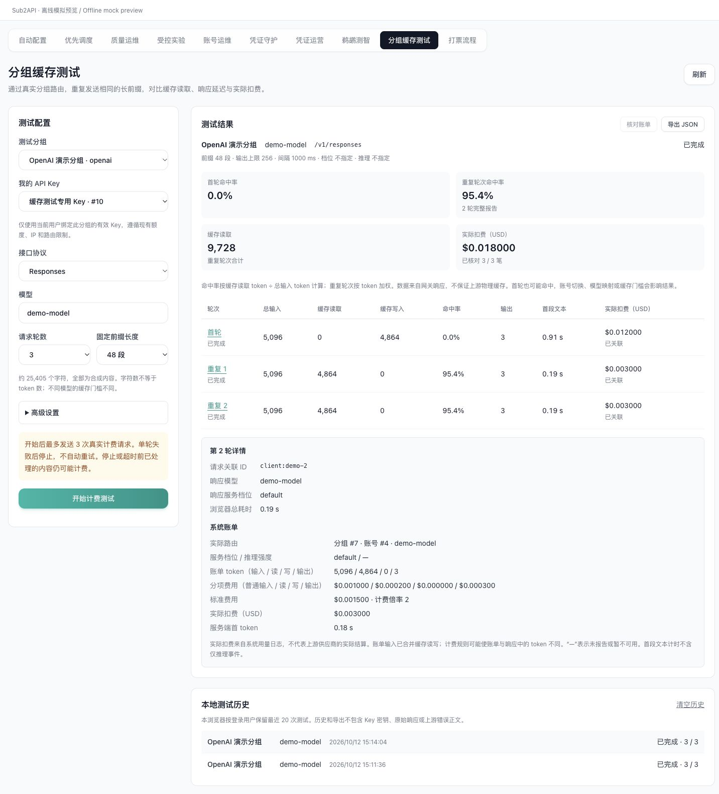
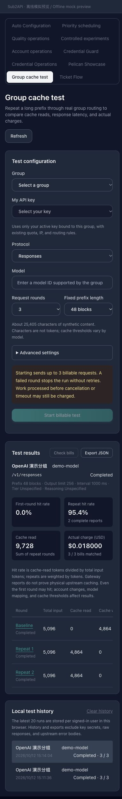

# 分组缓存测试

管理员入口：**智能运维 → 分组缓存测试**，路径为 /admin/group-cache-tests。

这个页面通过当前登录用户已有的分组 API Key，调用正常网关，观察该分组在连续请求中的缓存表现。测试会产生真实计费；默认 3 轮、48 段合成前缀、1 秒间隔、单轮 120 秒超时、最大输出 256 token。一次最多 6 轮，失败即停止，页面不会自动重试模型请求。网关自身既有的调度及故障转移规则仍然生效。

## 使用

1. 选择一个有效分组，再选择**当前登录用户**绑定此分组的有效 Key。没有 Key 时，先到“我的 Key”页面自行配置。页面不创建 Key、不代用其他用户的 Key，也不修改分组。
2. 输入分组支持的模型 ID，选择对应接口。模型建议列表仅供参考，不保证当前 Key 有权使用所有候选模型。
3. 根据需要调整前缀长度、轮数、间隔、超时、输出上限，以及 Responses / Chat 的服务档位和推理强度。参数必须由模型支持；推理模型可能需要增加输出预算。
4. 点击“开始计费测试”。每次测试使用一个新的随机标记，同次测试各轮保持前缀不变，只改变末尾的轮次标记。
5. 在结果表点击“首轮”或“重复”展开响应模型、服务档位、耗时、关联 ID，以及系统账单的实际路由、token、费用分项与倍率。
6. 可停止测试，或等待完成后导出 JSON。关闭页面也会取消正在进行的请求。已被服务端处理的部分仍可能计费。
7. 系统日志可能晚于响应入库。自动核对有次数及时间上限；未匹配时显示“待核对”，稍后点击“核对账单”只会查询日志。

## 协议与指标

| 协议 | 端点 | 缓存请求方式 | 响应用量 |
| --- | --- | --- | --- |
| Responses | /v1/responses | 相同早期输入前缀 | input_tokens 及 input_tokens_details |
| Chat Completions | /v1/chat/completions | 相同早期消息前缀；stream_options.include_usage | prompt_tokens 及 prompt_tokens_details |
| Messages | /v1/messages | 在固定文本块末尾添加 cache_control: ephemeral | input_tokens、cache_read_input_tokens、cache_creation_input_tokens |

接口只发送合成参考材料，不接受私人长文本，也不保存模型回答。不同模型/上游的缓存门槛、TTL、缓存写入报告与参数支持不同；字符数不等于 token 数，不保证某个长度一定命中。没有报告的缓存字段显示“—”，不会推断为零。若响应提供 cache_write_tokens 则记录它，否则 OpenAI 兼容接口的写入量保持未知。

- **命中率** = 缓存读取 token / 总输入 token；读取与写入分开。Responses / Chat 的输入已含缓存，Messages 的输入需合并三个桶。
- **重复轮次命中率**按完整且具有有效缓存数据的轮次累加 token 后计算，不平均百分比。摘要明确显示参与计算的轮数。
- **首段文本**是浏览器发起请求至第一段非空文本的时间，不包含仅推理事件。服务端首 token 和浏览器总耗时在详情中分别展示。
- **实际扣费**来自系统 usage log 的 actual_cost。账单 input_tokens、cache_read_tokens、cache_creation_tokens 是分开的桶，展示总输入时才相加。
- 响应 token 和账单 token 各自保留，不互相覆盖。强制缓存计费、模型映射、账号切换、定价和倍率等配置可能造成差异。
- 页面显示的是网关报告和本系统账单，不能证明上游物理缓存命中，也不代表上游供应商的实际结算。首轮同样可能命中缓存。

## 请求与账单的关联

网关返回 X-Client-Request-ID，页面以 `client:<ID>` 查询 /api/v1/admin/usage，且同时限制当前用户和本次 Key。不会按时间、模型或 token 数猜测匹配，不依赖浏览器自行发送的关联 ID。跨域部署需保留 CORS 暴露的 X-Client-Request-ID；缺少该响应头时明确显示“无关联 ID”。

即使超时、取消或 SSE 错误，也保留已观察到的请求 ID 和用量，以便后续只读核对。HTTP 200 不等于成功：必须收到协议的正常终止事件。无效 SSE、提前 EOF、上游错误和输出截断都使本轮失败，并停止后续轮次。

## 保存范围与限制

- 历史仅存在当前浏览器，按登录用户隔离，最多 20 次；刷新后可查看与导出，未完成记录显示为已停止。
- 持久化和导出逐字段白名单处理，不包含 Key 密钥、面板 JWT、原始请求/响应、上游错误正文、完整用户或账单对象。
- 本功能没有定时测试、服务端历史、跨分组并发比较、自动配置/降级或 Key 创建。离开页面后不会继续运行。
- 没有数据库迁移或新服务端测试执行接口。回滚前端即可移除页面；额外 CORS 响应头不改变现有网关鉴权和计费规则。

## 验证与截图

新增单元测试覆盖三种协议、固定前缀、token 归一化、加权统计、缺失用量、SSE 分片、HTTP 错误、EOF、超时、取消、精确账单匹配、延迟/失败查询、历史白名单及损坏数据。页面测试覆盖 Key 所有权与分组校验、切换竞态、停止、卸载及历史核对。测试已加入 Makefile 的前端关键用例集合。

下图使用虚构分组、虚构 Key 和本地模拟 SSE/账单，仅验证 UI 交互。页面主体和导航使用实际组件，外层使用简化的离线预览布局。没有连接生产数据库或发送真实付费模型请求。真实缓存收益仍需在目标部署中由操作者测试。

