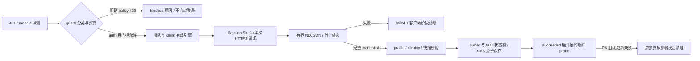

# Session Studio 重登：源码对照与验收边界

本文基线为 v2.17.1 / `cc9e57a93`。本次修复客户端确定的合同缺口与 403 分类；**没有证明 #504 / #532 的远端登录失败已经恢复**。#518 的 `credential accepted` 是探测结果，不能代替本次重登 task、原子保存及其后的新鲜鉴权复验。

## 公开参考及许可

2026-10-24 只读核实 [poxiao33/toSub2 main](https://github.com/poxiao33/toSub2/tree/8548397e89bf80e508eda64a87e0d556d43abc84) 仍为历史固定 `8548397e89bf80e508eda64a87e0d556d43abc84`；不是升级依赖。许可证为 [MIT / Copyright (c) 2026 poxiao33](https://github.com/poxiao33/toSub2/blob/8548397e89bf80e508eda64a87e0d556d43abc84/LICENSE)，LICENSE blob `a05ee217b1decba7f26a503ce5a4573c6139b02f`，protocol-login blob `ff2db2507e401c29fa78705e44f5b40a3108a8c6`。没有复制该项目实现；运行包原有 `tosub2/LICENSE` 及版权保留。

以下行号对应固定参考的 `src/protocol-login.mjs`：

| 阶段 | 实际源码 | 本仓库对应边界 |
| --- | --- | --- |
| Web 登录与 MFA | 989、1137；Web 登录不等于 OAuth 输出 | Session Studio 客户端不能观察其内部登录步骤；不根据邮件或 active 声称成功 |
| OAuth state / PKCE | 1394：随机 verifier、S256、state，1414 随回调保存；1469 校验恢复参数存在 | #557 本地适配核对 callback/state/PKCE/workspace；Session Studio 内部验证无法从公开参考证明 |
| 账号 session / workspace | 1436 `/api/accounts/session/select`；1515 `/api/accounts/workspace/select`；2003 选择逻辑 | claim 绑定 `expected_workspace`，后端比较持有账号的 account/user/email；不会通过切会话绕拒绝 |
| callback / 身份交换 | 1522 回调与 verifier/state；1687 取 code；1746 `/oauth/token`；1760 `code_verifier` | 本地 callback 经后端绑定 session 交换；Session Studio 返回完整 credentials，后端不重复兑换未知 code |
| 成功与失败 | 1790 要求三凭据；638 原子输出导入文件；2405 顶层失败设 exitCode=1 | 不接受半凭据、阶段完成或非零进程 exit；远端失败继续失败 |
| API / 事件形状 | `src/console-server.mjs:135` HTTP 路由、335 `/api/jobs/relogin-batch`；`protocol-login.mjs:1737` 导入文件 `sub2api-data/accounts` | 参考没有本仓库 `/api/v1/relogin` 的 `type=result/payload/credential` NDJSON 合同，不能据其改写远端请求或臆测其内部服务 |

参考本身有检查点恢复、刷新和重试逻辑。本次不移植这些策略，也不自动更换代理、引擎或会话。#555 解决进度事件误终结；#557 的本地 Codex 修复不能被称为 Session Studio 根治。

## 确定缺口及修改

1. 默认 JSONDecoder 对重复字段取最后值。原始 fixture 中先有失败 `error` / `status` / `payload`，后同名字段可以将其覆盖成完整凭据成功。现在所有对象层级拒绝重复键，包括转义后同名键；异常立即终止，不进入“不完整 JSON 等待更多数据”的路径，不尝试后续成功。非 JSON 的 NaN/Infinity 也拒绝。新增 fixture 是合成的合同回归，**没有证据表明线上服务返回过重复字段**。
2. guard v2 原先把全部 models HTTP 403 归为 auth，可以在预算尚可用时为明确 policy/session 拒绝创建新登录。现在先复用仓库已有的 `isOpenAIUpstreamSessionBlocked`、`detectOpenAICyberPolicy`、`isOpenAIRequestScoped403` 结构判定；作为 transient 保存固定 blocked 原因，继续巡检但不自动重登，不增加 auth fail streak，不恢复预算/清冷却。未知、账号级 403 保持原处理；不依赖 message 子串或输入回显识别策略。
3. Worker 原先把远端 error/failed/error/auth_failed 全部显示为 `Session Studio login failed`。现在 fail API 可携带严格白名单的**客户端观察阶段**，后端校验后派生 diagnostic 展示。远端原始 code/message/stage、URL、正文、凭据或环境不进入诊断。后台任务依然是 failed。

| 客户端阶段 | 含义 | 可能的固定原因 |
| --- | --- | --- |
| http_request | 向已配置地址发起一次请求 | http_rejected、transport_error |
| event_stream | 接收和解析有界 JSON/NDJSON | duplicate_field、invalid_json、unsupported_event、timeout、missing_result、response_too_large、transport_error |
| terminal_result | 已读到显式终态或合法旧终态 | provider_failed、invalid_result |
| credentials_validation | 客户端检查三项非空字符串 | credentials_incomplete |
| credentials_submit | 提交后端校验和原子回写 | submission_failed、credentials_not_accepted |

字段限 stage/reason、0–3600000ms 耗时和 HTTP 拒绝时的 100–599 状态码。`http_status=0` 是没有 HTTP 拒绝码，不代表远端 HTTP 0；JSON 展示省略它。Session Studio diagnostic 标识 engine，不伪造进程 exit；本地原有 exit_code（含 0）仍保留。格式/阶段原因组合/上限/额外内容不合法时输出固定错误，禁止回显输入。

进度仍遵守 #555 已有合同：`type=progress/heartbeat` 是通知；其诊断 error 不成为登录成功或终态。首个 `type=result` 或合法旧 JSON 的明确失败仍拒绝，绝不为等待成功而跳过。未知类型携带结果字段、无效终态、无终态 EOF、半凭据、HTTP 重定向均拒绝；普通无结果通知继续兼容。不从通知推断提供方内部终态定义。

## 完整链路与保留的约束

- `openai_oauth_reauth.go:712` 与 repository `openai_oauth_reauth_repo.go:172`：有效引擎由全局/账号/mode 计算；Excel/SIWC 固定本地，不由显示配置猜当前任务。claim SQL 保留活跃唯一约束、SKIP LOCKED 和 stale 回收；每个失败报告仍受 worker ownership/status 约束。
- `tools/openai_oauth_reauth_worker.py:1074`：保留已配置 HTTPS endpoint、原 action/auth_mode/email/password/mfa_secret 合同、Origin/Referer/额外头与 UUID；不接收账号代理、不发内部 worker token、不跟重定向、不自动重发。没有新的参考项目专用字段。
- `openai_oauth_reauth.go:1003/1043/1209`：direct credentials 要求密码模式、正确 profile、完整可解析 ID token，比较原账号 workspace/account/user/email，检查任务捕获的凭据 hash。这里不是验证远端内部 state/PKCE 的替代品。
- `repository/account_repo.go:1125/1153/1184/1187`：原任务 owner/status 行锁、账号 credentials expected-value CAS、账号更新与 task succeeded 在同一 SQL 中；未拆成先成功再写凭据。缓存失效沿用原流程。
- `account_token_guard_v2_budget.go:59`：失败与成功后 auth 按 task 幂等核算；只有成功后开始且对应最新任务的新鲜 OK 才能清预算。active、accepted 或保存成功本身不重置耗尽状态。没有改预算、阈值、冷却、恢复 API 或线上账号。

## 离线与线上 gate

本机仅 Python AST / gofmt / diff；动态行为尚未验证。`tools/fixtures/session-studio/*.ndjson` 包含重复 error/status/payload、转义同名、失败后成功、进度后成功。engines 测试沿现有双架构 runtime Dockerfile 执行，fixtures 明确复制并列入 PR path；Go 服务测试及 Vue 展示走既有 CI。既有 19 个 engines 测试方法及断言未改，未删 skip。

父审后同一 Draft PR 当前 head 必须通过 runtime amd64/arm64、后端 unit/integration、frontend critical、相关 lint/security 及隔离应用 gate；本机禁令不改远端检查要求。具体执行状态见交付 verification，不把源码测试等同已通过。

生产与远端内部仍阻塞：没有访问服务响应、生产 DB/SSH、真实登录或付费模型；无法从公开 toSub2 得知 Session Studio 失败是否在 state/PKCE/callback、workspace、交换、挑战、出口或服务实现。诊断生效也不等于恢复。后续只在单独授权后，用自然发生的 task/attempt/有效引擎、白名单阶段与 CAS 终态及新鲜 probe 关联验收；不采集原始响应或秘密，不为测试恢复预算、换会话或重试真实登录。
