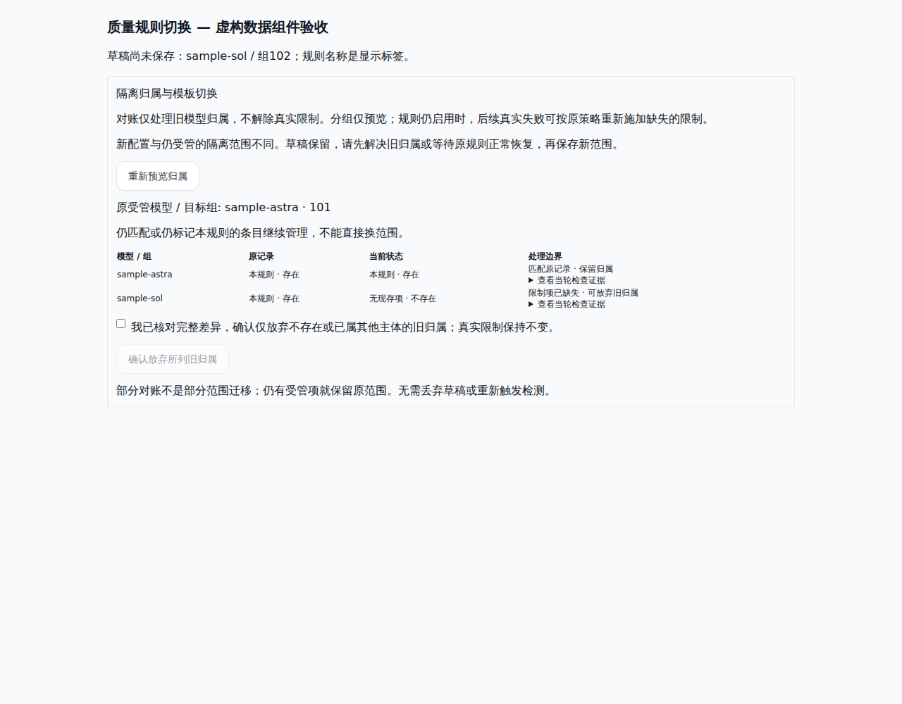
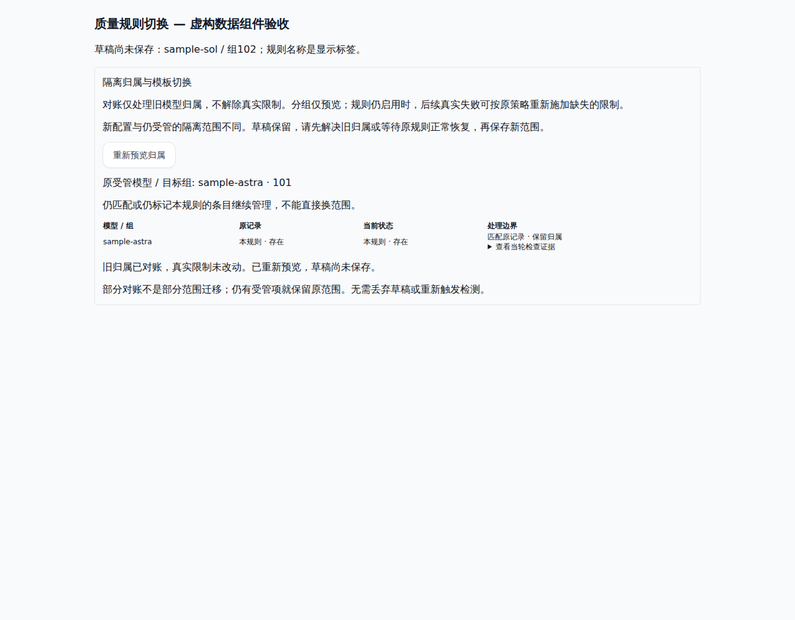
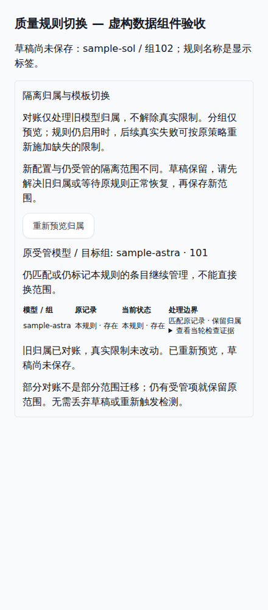

# 质量模板冲突：实际组件的离线截图

- 渲染源码：4d249c12b08d67ea3e45f542f89a2b5413a38001。
- 远端GitHub Actions：run40174264233，job121111453381，成功。
- QualityOwnershipReview.vue真实Vue组件，通过Vite/项目Tailwind渲染。数据为固定虚构账号/规则/model/group ID；全部API由内存fixture替代，无真实账号、凭据、生产请求或付费调用。
- 截图范围是组件交互预览，不代表整页导航/生产后端或真实检测已验收。
- 旧组件没有这一预览/确认入口，因此不存在相同组件的修改前截图；原行为400/500由远端红例验证。

