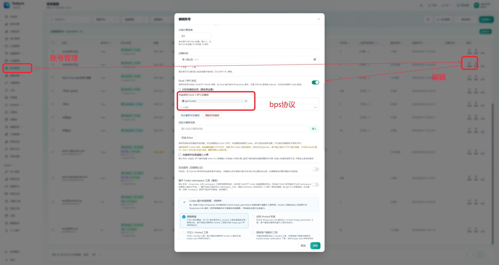
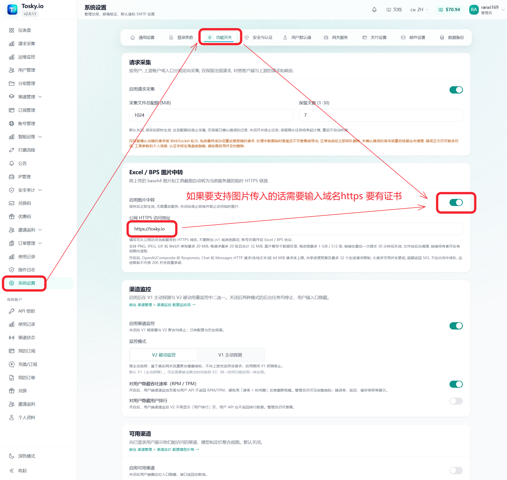

# Sub2API 新人入门

已经托管账号或完成部署，想在电脑上的 Codex 中使用？请看[新人入门：使用 Sub2API 接入 Codex](新人入门-使用Sub2API.md)。

本文面向第一次部署 Sub2API，或已经部署官方版、准备切换到本 fork 的用户。安装示例固定为已发布的 `v2.11.1`。功能与菜单以实际安装版本为准；升级前先阅读对应版本的[发布说明](https://github.com/ranxi2001/sub2api/releases)。

## 1. 选择部署位置

正式服务建议部署在 Linux VPS。Mac、Windows、Linux 电脑作为客户端访问 VPS 网关即可；本机部署适合测试，通常只供本机或局域网使用。

## 2. 安装或替换为 fork 版

在 VPS 的 Linux 终端执行：

```bash
curl -fsSL https://raw.githubusercontent.com/ranxi2001/sub2api/v2.11.1/deploy/install.sh \
  | sudo bash -s -- install -v v2.11.1
```

也可以使用 Docker 镜像：

```bash
docker pull ghcr.io/ranxi2001/sub2api:2.11.1
```

只执行 `docker pull` 不会启动服务，Docker 的数据目录、数据库、端口映射和启动步骤请参阅[部署文档](../deploy/README.md)。

如果 VPS 已经安装官方版，可以按同一安装流程替换二进制。替换前请备份数据库和配置，确认数据目录、端口和服务名一致；不要同时启动两个占用同一端口的版本，也不要删除原数据目录。升级后在后台确认版本为 `v2.11.1`，并检查账号、分组、渠道和历史数据。

## 3. 首次配置

1. 为 VPS 配置域名和 HTTPS。
2. 在后台创建用户、分组和 API Key。
3. 在「账号管理」中添加上游账号。
4. 先用一个账号完成测试，再批量配置。

## 4. 开启 Excel / BPS

BPS 按账号和模型启用：

1. 进入「账号管理」，编辑 OpenAI OAuth / ChatGPT 账号。
2. 打开「Excel / BPS 协议」。
3. 在模型选择框中勾选需要走 BPS 的模型，例如 `gpt-6-astra`。
4. 点击「更新」保存。



账号较多时，可以使用账号列表的批量设置功能，统一修改协议开关和模型范围。建议先用少量账号验证。

需要重新取得 Excel 会话时，使用「添加账号 → OpenAI → BPS OAuth（官方 Excel 登录）」完成授权，详见 [BPS OAuth 登录](excel-bps.md#bps-oauth-登录)。不要仅修改 `client_id` 或混用 Codex 与 Excel 的 refresh token；Free 套餐账号不能开启 BPS。

BPS 主要面向支持的 OpenAI OAuth / ChatGPT 账号，不是通用的 Claude 增强开关。未勾选的模型继续走原有 Codex 路径；BPS 不会自动提升账号权限、额度或模型可用范围。界面中的 `Max` 可能是网关到上游的推理等级映射，不能理解为上游一定存在独立的 Max 档位，也不能据此保证模型不会降智。

## 5. 质量运维

新人部署和 Excel / BPS 配置不再包含旧版 780 / 292 打票步骤；无需跟随旧教程寻找这些开关、配置采票端口或搭建 Keeper。账号质量通过实际答题与判题记录评估，票据长度不能证明模型能力。

管理员在侧边栏进入「质量运维」，按以下步骤配置：

1. 先固定被测账号、模型、推理强度和题目；建议先用一个账号完成检测。
2. 新建检测规则，填写参考答案、检测模型、五段 Cron 和每轮次数，并配置判题模型、判题分组与提示词。内置糖果题的历史参考答案为 `21`，自定义题目必须使用对应答案。
3. 按实际需要选择失败处置和目标分组，核对自动恢复开关后保存。各版本支持的动作及恢复条件见[账号质量运维](account-quality-operations.md)。
4. 点击「立即检测」后等待服务端扫描执行，再到「运营记录」核对回答原文、判题理由、通过次数和实际处置结果。
5. 网络超时、鉴权错误、未完成响应或判题不确定时，先排查调用链路，不据此判定账号降智。

质量检测和判题会产生真实模型调用，结果只代表当前题目和配置下的表现。关闭网页不会停止已保存的服务端任务；需要停止时暂停规则。暂停或删除规则不会自动恢复此前的处置，操作前先检查账号状态。

## 6. 图片中转

需要让 Excel / BPS 处理图片或工具截图时，进入「系统设置 → 功能开关」，按需开启「Excel / BPS 图片中转」，并填写有有效证书、可从公网 HTTPS 访问的域名。没有图片需求时可以保持关闭。



不要填写 `127.0.0.1`、内网地址或无证书的 HTTP 地址。上传内容可能包含用户数据，域名和日志应按实际安全要求保护。

## 7. 客户端接入

Mac、Windows、Linux 客户端只需使用 VPS 网关的 OpenAI 兼容 Base URL 和 Sub2API API Key，不需要重复部署服务。Base URL、路径和可用模型以后台渠道配置和部署文档为准。创建 API Key、配置 Cockpit Tools 和验证调用的步骤见[使用 Sub2API 接入 Codex](新人入门-使用Sub2API.md)。

## 常见问题

### 已部署官方版，可以直接替换吗？

可以，但先备份数据库和配置，确认数据目录、端口和服务名一致。升级后核对版本、账号数据和一条实际请求。

### 只打开 BPS 开关够吗？

还要在账号编辑页选择具体模型并保存。未选择的模型不会走 BPS。

### Claude 反代有特别增强吗？

本 fork 的相关说明主要围绕 OpenAI OAuth / Codex 和 Excel / BPS。Claude 可用性应按实际渠道、账号和上游协议单独测试，不能由 BPS 配置推断。

### BPS 请求失败怎么办？

先做一次关闭 BPS 的对照请求，再检查账号状态、模型限制、分组权限、渠道定价和服务日志错误码。不要在群里发送 Token、Cookie、Recovery Ticket 或完整请求正文。

## 安全提醒

- 管理后台、API Key、OAuth 凭据、Cookie、代理订阅 URL 和 Recovery Ticket 都是敏感信息。
- 不要把真实凭据写入命令历史、截图、Git 或群聊。
- 生产升级前备份数据库；升级后检查服务状态和实际请求。

相关功能说明：[Excel / BPS](excel-bps.md)、[账号质量运维](account-quality-operations.md)。
